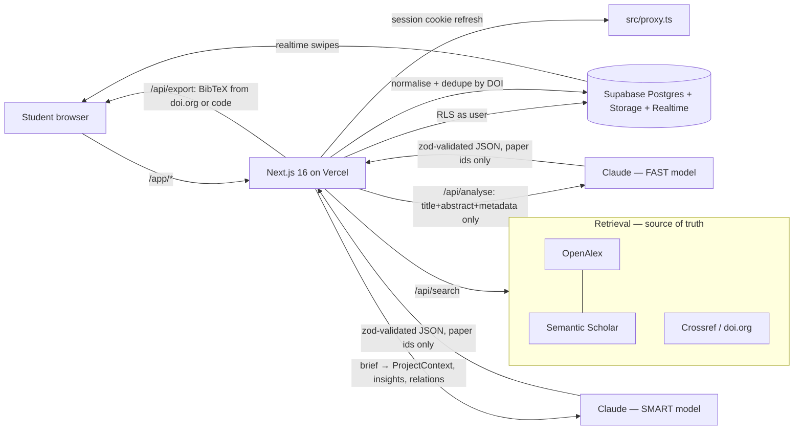

# PaperCut — architecture

> Product summary copied from docs/SETUP_PLAN.md §2. Contracts: `src/types/domain.ts`, `src/lib/api-schemas.ts`. Schema: `supabase/migrations/`.

**Track:** Better Student Life (Claude hackathon, London).
**Pitch:** "Tinder for research papers." Tell it what you're writing; swipe through _real_ papers; Claude explains in one line why each matters _for your assignment_; walk away with a clean, correct bibliography.

## Core loop

1. Create a **project** (= a research question / assignment). Optionally upload the coursework brief / marking rubric (PDF, DOCX, text).
2. Claude parses the brief once into a compact **project context**: topic, key claims/positions to test, required themes, constraints (e.g. date range).
3. Search query → retrieve candidates from OpenAlex/Semantic Scholar → normalise → dedupe by DOI.
4. For each paper, Claude (fast model) produces a **structured analysis from the retrieved title+abstract+metadata only**:
   - `overview` (≤ 35 words, simplified abstract)
   - `why_it_matters` (≤ 20 words, one line, relative to the brief)
   - `relevance` 0–100 + one-phrase reason
   - `stance` toward each key claim: `supports | challenges | neutral | unclear`
   - `methodology` and `limitations` (≤ 15 words each, "not stated in abstract" allowed)
   - `use_as`: `evidence | counterpoint | background | method`
5. **Credibility is computed, not generated**: citation count, venue type, peer-reviewed flag, recency → deterministic score shown with its inputs.
6. Swipe right = save, left = skip, up = details. Keyboard: ← → ↑, Z = undo; read aloud via the Listen button or voice.
7. **Library**: saved papers per project, persisted (fixes "papers disappear"), sidebar of past projects like a chat history.
8. **Exports**: BibTeX (`.bib`, fetched from doi.org content negotiation where DOI exists, otherwise built from metadata by code), LaTeX `thebibliography` block, CSV, Markdown reading list, "copy `\cite{key}`".
9. **Relations view** (on the saved set, not per card): Claude groups saved papers into supports / challenges / methods, flags complementary vs contrasting pairs — using only papers in the library.

## Differentiators (priority order)

- **P0 (must demo):** landing page, project + brief upload, search → analyse → swipe → save, history sidebar, BibTeX/CSV/LaTeX export, deployed on domain.
- **P1:** group sessions (shared swipe, compiled reading list, disagreement flags), adaptive swiping (re-rank + "I noticed you skip X" insight), relations view.
- **P2:** voice/a11y mode (TTS abstracts, voice commands), lit-review scaffold (outline with `\cite` keys validated against library), synthesis matrix export.

## Anti-hallucination rules (non-negotiable, also in CLAUDE.md)

- Claude never produces titles, authors, years, venues, DOIs, or BibTeX. All bibliographic data comes from retrieval APIs and is rendered by code.
- Claude output is JSON validated with zod; it references papers only by our internal `paper_id`. Any unknown id is dropped server-side.
- Prompts include "If the abstract doesn't say, answer `not stated`."
- Summaries have hard word limits enforced in the schema (fixes "too long/boring").

---

## Data flow

**Trust boundary:** Claude only ever sees records retrieved from OpenAlex / Semantic Scholar and
returns JSON that references our internal `paper_id`s. Titles, authors, years, venues, DOIs, URLs
and BibTeX are always rendered by code from retrieved data. Credibility is computed in
`src/lib/credibility.ts`.

## Tables (see `supabase/migrations/20261015000000_initial_schema.sql`)

| Table / view                          | Purpose                                                                   | Access                                        |
| ------------------------------------- | ------------------------------------------------------------------------- | --------------------------------------------- |
| `profiles`                            | display name per auth user (auto-created)                                 | self + collaborators                          |
| `projects`                            | research question, parsed `context` (ProjectContext), `join_code`         | members; owner writes                         |
| `project_members`                     | owner/member rows (owner added by trigger; join via `join_project(code)`) | members                                       |
| `project_documents` + bucket `briefs` | uploaded briefs at `briefs/<project_id>/<file>`                           | members                                       |
| `papers`                              | shared cache of normalised `Paper` JSON, unique `(source, external_id)`   | any signed-in user reads; service role writes |
| `paper_analyses`                      | `PaperAnalysis` + `Credibility` per project × paper                       | members                                       |
| `swipes`                              | save/skip per project × paper × user (Realtime enabled)                   | members read; own writes                      |
| `reading_list` (view)                 | papers with ≥ 1 save, with save/skip counts                               | members                                       |
| `disagreements` (view)                | papers with both saves and skips                                          | members                                       |

## API routes

| Route                              | Method         | Owner               | Request → response (zod in `src/lib/api-schemas.ts`)                                                 |
| ---------------------------------- | -------------- | ------------------- | ---------------------------------------------------------------------------------------------------- |
| `/api/search`                      | GET            | search (SE-05)      | `searchRequestSchema` (query string) → `searchResponseSchema`                                        |
| `/api/analyse`                     | POST           | ai (AI-04)          | `analyseRequestSchema` → NDJSON stream of `analyseStreamEventSchema`                                 |
| `/api/projects`                    | GET / POST     | projects (PR-01/02) | → `projectListResponseSchema` / `createProjectRequestSchema` (+ multipart `brief`) → `projectSchema` |
| `/api/projects/[projectId]`        | PATCH / DELETE | projects            | `updateProjectRequestSchema`                                                                         |
| `/api/projects/[projectId]/swipes` | POST / DELETE  | swipe (SW-05)       | `swipeRequestSchema`                                                                                 |
| `/api/export/[projectId]`          | GET `?format=` | export (LB-02/03)   | `exportRequestSchema` → file download                                                                |

Errors are `{ error, details? }` (`apiErrorSchema`). Placeholders currently return 501.

## Routes (pages)

| URL                          | File                                            | Owner     |
| ---------------------------- | ----------------------------------------------- | --------- |
| `/`                          | `src/app/(marketing)/page.tsx`                  | marketing |
| `/app`                       | `src/app/app/page.tsx` + `layout.tsx` (sidebar) | projects  |
| `/app/p/[projectId]`         | swipe deck                                      | swipe     |
| `/app/p/[projectId]/library` | saved + export                                  | library   |
| `/app/join/[code]`           | group join                                      | group     |
| `/app/_styleguide`           | `src/app/app/%5Fstyleguide/page.tsx`            | design    |
